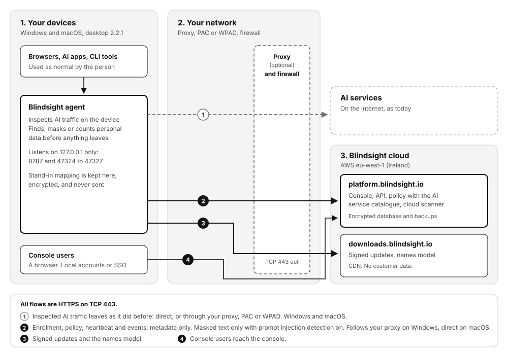
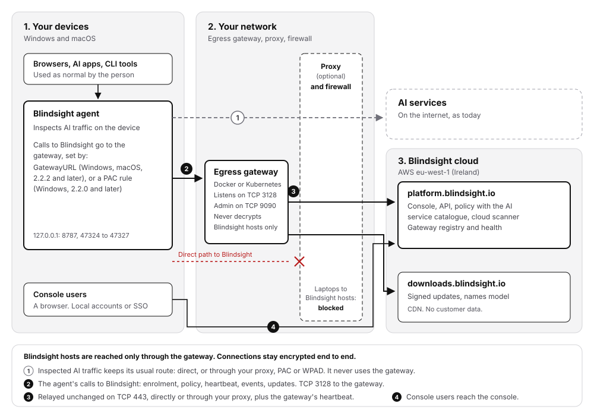
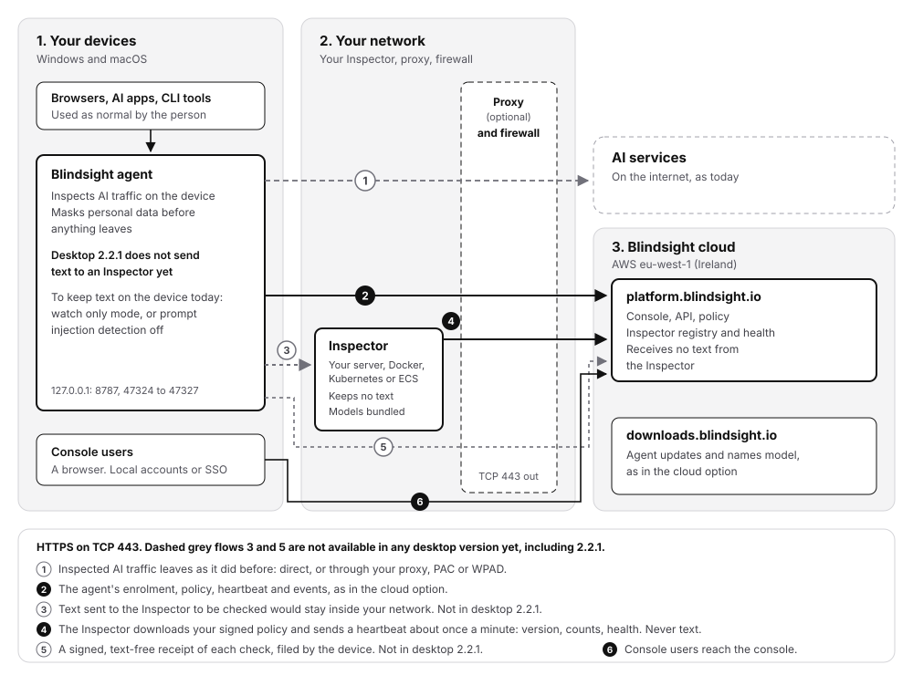

A deployment has three tiers: the agent on each device, your network, and the
Blindsight platform. These diagrams show the Blindsight cloud.
Every arrow is a flow from [Network and firewall](/endpoint/plan/network), and the
[data flow page](/endpoint/plan/data-flow) says what each one carries.

## The cloud option

The agent inspects AI traffic on the device, then lets it leave as it did before.
The agent talks to two Blindsight hosts. In watch only mode, or with prompt
injection detection off, only metadata reaches the platform. With prompt injection
detection on, the masked text also reaches the cloud scanner, which runs inside the
platform.

<Frame caption="The cloud option. Flow 2 follows your proxy on Windows, and on macOS from desktop 2.2.2.">
  
</Frame>

| Tier | Component | Runs where | Who runs it |
| ---- | --------- | ---------- | ----------- |
| 1 | Blindsight agent: the `BlindsightDLP` service and tray app on Windows, the app and root guardian on macOS | Each device | You deploy it. See [Packaging and silent install](/endpoint/plan/silent-install). |
| 2 | Your proxy, PAC file or WPAD, and firewall | Your network | You. Nothing from Blindsight is installed here. |
| 3 | Console, API, policy, cloud scanner, database | `platform.blindsight.io`, AWS eu-west-1 (Ireland) | Blindsight |
| 3 | Update manifests, installers, names model | `downloads.blindsight.io` | Blindsight |

## The egress gateway option

The same as the cloud option, with one exit point: every agent sends its calls to
Blindsight to the egress gateway in your network, and only the gateway reaches
Blindsight. The gateway relays the encrypted connections without decrypting them.
Inspected AI traffic keeps its usual route. See [Egress gateway](/endpoint/plan/gateway).

<Frame caption="The egress gateway option. Direct TCP 443 from laptops to the Blindsight hosts is blocked.">
  
</Frame>

| Tier | Component | Runs where | Who runs it |
| ---- | --------- | ---------- | ----------- |
| 1 | Blindsight agent, pointed at the gateway by a PAC rule (Windows) or the `GatewayURL` setting (Windows and macOS, desktop 2.2.2 and later) | Each device | You deploy it |
| 2 | Egress gateway: Docker or Kubernetes, 0.25 vCPU, 256 MB RAM, no disk | Your network | You. Blindsight supplies the image. |
| 2 | Your proxy (optional) and firewall | Your network | You |
| 3 | Console, API, policy, cloud scanner | `platform.blindsight.io` | Blindsight |
| 3 | Update manifests, installers, names model | `downloads.blindsight.io` | Blindsight |

## The Inspector option

The Inspector is a scanner you run in your own network, built so that text a device
sends to be checked never reaches Blindsight. It downloads your signed policy from
the platform and reports its health. The device would then file a signed receipt of
each check, with no text, with the platform.

<Frame caption="The Inspector option. Dashed grey flows are not available for endpoints.">
  
</Frame>

| Tier | Component | Runs where | Who runs it |
| ---- | --------- | ---------- | ----------- |
| 1 | Blindsight agent | Each device | You deploy it |
| 2 | Inspector | Your server: Docker 24 or later, Kubernetes 1.27 or later, or AWS ECS on Fargate, 64-bit x86. Sizing: 4 vCPU and 10 GB RAM, 2 vCPU at least. | You. Blindsight supplies the image. |
| 2 | Your proxy and firewall | Your network | You |
| 3 | Console, API, policy, Inspector registry | `platform.blindsight.io` | Blindsight |

The Inspector needs outbound HTTPS to `platform.blindsight.io` only, inbound HTTPS
from devices on one port (443 by default), and a certificate you control for the
name devices use. Its detection models are inside the image, so it downloads nothing
at run time.

## What is not in either diagram

- **A relay through the Inspector.** The Inspector checks text. It does not carry
  the agent's other traffic.
- **A Swiss region.** The platform runs in AWS eu-west-1 (Ireland).

## Optional additions

- **SIEM.** The platform can send events to your syslog collector over TLS. See
  [Syslog export](/endpoint/syslog-export).
- **Single sign-on.** Console users and Mac users sign in through your OpenID
  Connect provider. See [Single sign-on](/permissions-and-access/single-sign-on).
- **Intune.** Blindsight can read your Intune tenant and build the agent's Intune
  app for you. See [Connect Intune](/endpoint/connect-intune).
